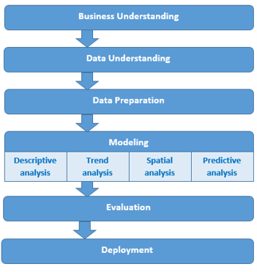
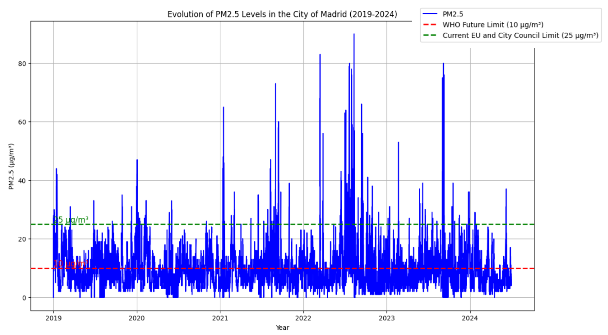
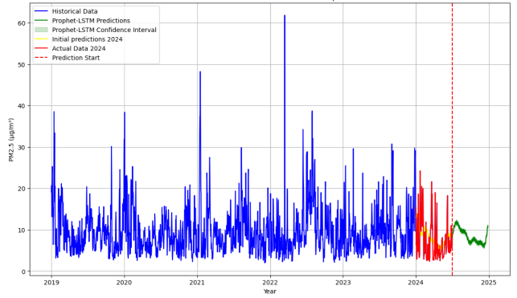

------------------------------------------------------------------------

## 🔗 Direct access

- 📄 [Published article](https://doi.org/10.3390/appliedmath4040076)
- 💻 [Analytical notebook](notebook.html)
- 🧪 [Scripts and workflow](scripts.html)
- 💾 [GitHub repository](https://github.com/jcaceres-academic/urban-pm25-forecasting)
- 📚 [Bibliographic reference set](https://doi.org/10.5281/zenodo.23880803)

------------------------------------------------------------------------

## 🧠 Overview

This repository contains the reproducible materials associated with the article **“Analysis and Prediction of PM2.5 Pollution in Madrid: The Use of Prophet–Long Short-Term Memory Hybrid Models.”**

The study analyses urban PM2.5 pollution in Madrid using:

- official open data from the Madrid City Council;
- a structured **CRISP-DM** analytical workflow;
- descriptive, temporal and spatial analysis;
- and a hybrid **Prophet-LSTM** forecasting strategy.

The study covers observations from **2019 to mid-2024** and combines citywide analysis with district-level interpretation.

------------------------------------------------------------------------

## 🧩 Methodological framework

The project adapts **CRISP-DM** to an urban environmental-data workflow integrating data preparation, exploratory analysis, spatial interpretation and forecasting.

{fig-align="center" width="66%"}

**Fig. 1.** Adapted CRISP-DM workflow used in the study.

------------------------------------------------------------------------

## 📈 Main empirical result

The historical analysis shows an overall reduction in PM2.5 concentrations over the study period, although relevant interannual variability and episodic peaks remain.

{fig-align="center" width="88%"}

**Fig. 2.** Citywide evolution of PM2.5 concentrations in Madrid from 2019 to 2024.

District-level behaviour, spatial differences and detailed descriptive results are documented in the [analytical notebook](notebook.html).

------------------------------------------------------------------------

## 🤖 Forecasting framework

The predictive stage combines **Prophet**, which models trend and seasonal structure, with **LSTM**, which captures nonlinear temporal dependencies.

{fig-align="center" width="88%"}

**Fig. 3.** Citywide PM2.5 forecast using the hybrid Prophet-LSTM approach.

District-level forecasts are available in the [analytical notebook](notebook.html).

------------------------------------------------------------------------

## 📌 Main findings

- PM2.5 concentrations show a **general downward trend** from 2019 to mid-2024.
- Important **year-to-year variability and pollution peaks** remain.
- PM2.5 patterns differ across monitored districts.
- The hybrid forecasting framework combines explicit temporal structure with nonlinear sequence modelling.
- The resulting analysis can support environmental planning and urban decision-making.

------------------------------------------------------------------------

## 🔬 Reproducibility

The repository preserves:

- the original Python analytical scripts;
- the associated data folder;
- selected figures from the study;
- Quarto documentation;
- and a machine-readable bibliographic reference set.

See [Scripts and workflow](scripts.html) for the computational structure.

------------------------------------------------------------------------

## 📚 References and citation

**Article DOI:** [10.3390/appliedmath4040076](https://doi.org/10.3390/appliedmath4040076)

**Zenodo bibliographic reference set:** [10.5281/zenodo.23880803](https://doi.org/10.5281/zenodo.23880803)

> Cáceres-Tello, J., & Galán-Hernández, J. J. (2024).  
> *Analysis and Prediction of PM2.5 Pollution in Madrid: The Use of Prophet–Long Short-Term Memory Hybrid Models.*  
> **AppliedMath, 4**(4), 1428–1452.  
> https://doi.org/10.3390/appliedmath4040076

------------------------------------------------------------------------

## 📬 Contact

**Jesús Cáceres Tello**  
Complutense University of Madrid

📧 [jescacer@ucm.es](mailto:jescacer@ucm.es)  
📧 [jcaceres.academic@gmail.com](mailto:jcaceres.academic@gmail.com)

⬅️ [Back to Academic Home](https://jcaceres-academic.github.io/)
