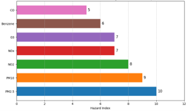
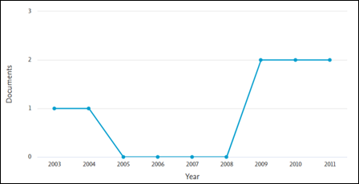
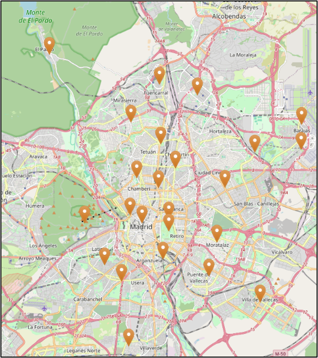
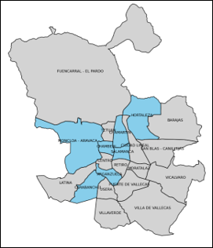
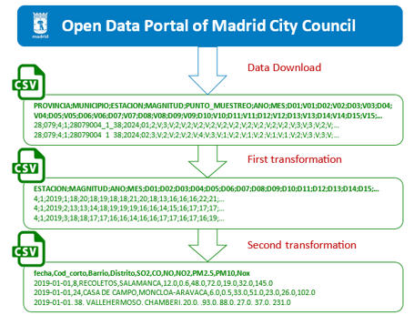
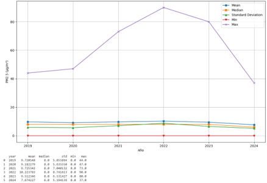
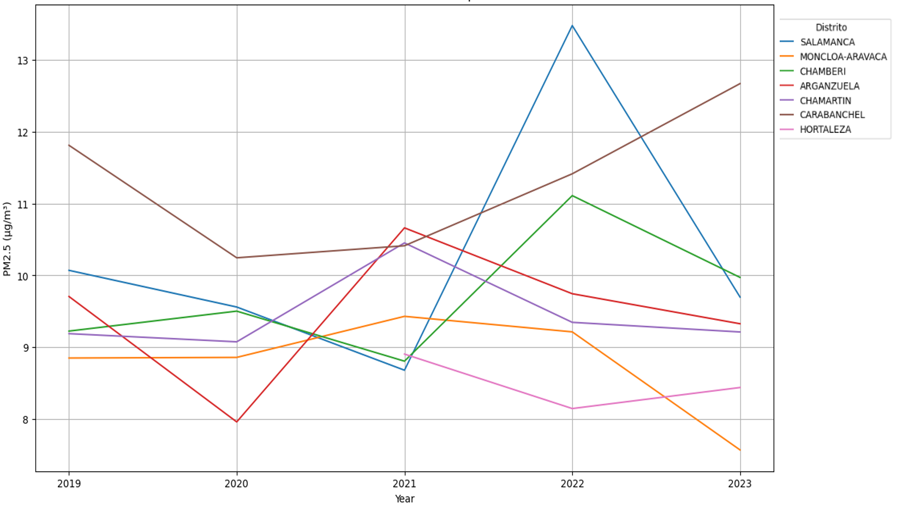
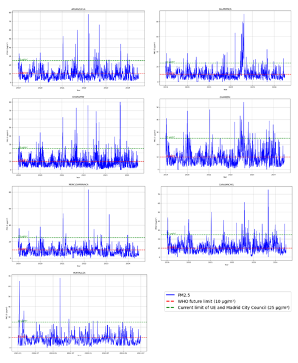
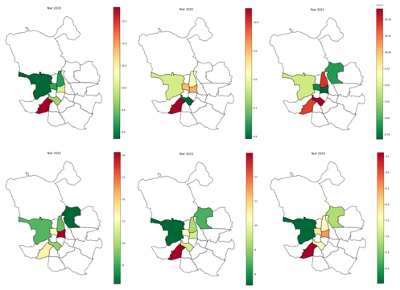
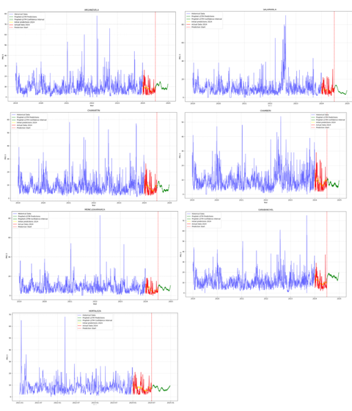

------------------------------------------------------------------------

## 🧠 Purpose

This notebook complements the project home page by documenting the **data context, monitoring coverage, preprocessing, descriptive analysis, district-level patterns and spatial results**.

The project home already presents the central methodological framework, citywide temporal evolution and citywide Prophet-LSTM forecast. Those figures are intentionally not repeated here.

------------------------------------------------------------------------

## 🌫️ Environmental context

The study begins by positioning PM2.5 within the broader health relevance of urban atmospheric pollutants.

{fig-align="center" width="70%"}

**Fig. 1.** Relative hazard index of the pollutants considered in the study.

The article also reviewed the evolution of scientific interest in PM2.5. One representative bibliometric view is retained here:

{fig-align="center" width="72%"}

**Fig. 2.** Publications related to Madrid and PM2.5 by year.

Additional bibliometric figures remain available in the `images/` directory but are not rendered here to keep the notebook focused.

------------------------------------------------------------------------

## 🌍 Monitoring coverage

The analysis uses official observations from the Madrid City Council air-quality monitoring network.

{fig-align="center" width="66%"}

**Fig. 3.** Madrid air-quality monitoring stations.

PM2.5 measurements are available only for a subset of districts:

{fig-align="center" width="66%"}

**Fig. 4.** Districts with direct PM2.5 monitoring coverage.

The analysed districts include Chamartín, Chamberí, Moncloa-Aravaca, Salamanca, Arganzuela, Carabanchel and Hortaleza.

------------------------------------------------------------------------

## 🔄 Data preparation

The raw municipal files were transformed into an analysis-ready structure before descriptive, spatial and predictive analysis.

{fig-align="center" width="78%"}

**Fig. 5.** Data acquisition and preprocessing workflow.

The preprocessing stage integrates observations across years and reorganises the source data by date, monitoring station, neighbourhood, district and pollutant.

------------------------------------------------------------------------

## 📊 Descriptive analysis

The descriptive analysis characterises the distribution and variability of PM2.5 over the study period.

{fig-align="center" width="84%"}

**Fig. 6.** Descriptive statistics of PM2.5 concentrations from 2019 to 2024.

The results show a reduction in central tendency over time, together with persistent variability and episodic high-concentration events.

------------------------------------------------------------------------

## 📈 District-level temporal behaviour

District-level analysis reveals that the temporal evolution of PM2.5 is not spatially homogeneous.

{fig-align="center" width="84%"}

**Fig. 7.** PM2.5 trends by district from 2019 to 2023.

A complementary district-by-district representation provides a more detailed view of the evolution relative to reference levels:

{fig-align="center" width="88%"}

**Fig. 8.** PM2.5 evolution by monitored district.

------------------------------------------------------------------------

## 🗺️ Spatial analysis

The spatial analysis summarises how PM2.5 concentrations vary across the monitored districts and over time.

{fig-align="center" width="82%"}

**Fig. 9.** Spatial distribution of PM2.5 concentrations by district.

This result supports the use of district-level analysis rather than relying exclusively on citywide averages.

------------------------------------------------------------------------

## 🤖 District-level forecasting

The citywide Prophet-LSTM result is presented on the project home page. The district-level extension is shown here:

{fig-align="center" width="88%"}

**Fig. 10.** Prophet-LSTM forecasts for individual Madrid districts.

This extension allows the forecasting framework to reflect local temporal differences across the monitored areas.

------------------------------------------------------------------------

## 🔬 Reproducibility notes

The repository preserves the original analytical Python scripts and the associated data folder.

The figures shown in this notebook are selected published outputs used to document the analytical stages. The complete script inventory and execution structure are described separately in [Scripts and workflow](scripts.html).

------------------------------------------------------------------------

## 📚 Persistent references

**Article DOI:** [10.3390/appliedmath4040076](https://doi.org/10.3390/appliedmath4040076)

**Zenodo bibliographic reference set:** [10.5281/zenodo.23880803](https://doi.org/10.5281/zenodo.23880803)

------------------------------------------------------------------------

## ⬅️ Navigation

[Project home](index.html) · [Scripts and workflow](scripts.html) · [Academic Home](https://jcaceres-academic.github.io/)
